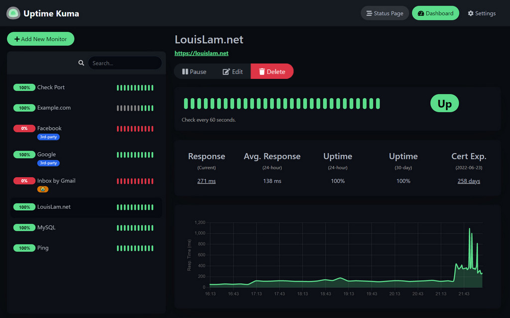

Why these settings?
Configuration	Purpose
louislam/uptime-kuma:2	Uptime Kuma v2 image
restart: unless-stopped	Restart automatically
3001:3001	Dashboard port
./data:/app/data	Persistent application data
Asia/Dhaka	Bangladesh timezone
healthcheck	Basic HTTP health monitoring

The local data directory is important. Your database and monitoring configuration will survive container recreation.

Uptime Kuma requires filesystem locking support. Use a local filesystem for this directory, not NFS.

====Start Uptime Kuma====
From the project directory:
cmd: docker compose config
If the configuration is valid, start the application:

cmd: docker compose up -d

Docker will download the Uptime Kuma image and create the container.

Check running containers:

cmd: docker compose ps

Check logs:
cmd: docker compose logs -f uptime-kuma

1. Recreate the container

docker compose down
docker compose up -d

docker compose ps

--for localhost:
http://host.docker.internal:8000

https://api.slack.com/apps?utm_source=chatgpt.com

What to do on this screen:

Click Add Bot Events (or type in the search box), then pick the events that match what your bot needs to do:

app_mention: the bot reacts when someone @mentions it. This is the most common choice and works for most bots.
message.channels: the bot sees all messages in public channels it has been added to.
message.im: the bot reads direct messages sent to it.
message.groups: the bot sees messages in private channels it's in.

====for server=====

docker --version
docker compose version

If both commands work, Docker is ready.

If not, we'll install Docker Engine and the Compose plugin.
Step 2. Create the deployment directory
Run on RHEL 9:
sudo mkdir -p /opt/uptime-kuma

sudo chown "$USER":"$(id -gn)" /opt/uptime-kuma

cd /opt/uptime-kuma

Expected files:
/opt/uptime-kuma/
├── compose.yaml
├── .gitignore
├── .env.example
└── README.md

Step 4. Prepare the Docker image
There is one important difference in your environment:

Your MacBook M4 uses ARM64 architecture, while your office server may use x86_64. Also, your office server does not have public internet access.

Check the server architecture:
uname -m

If it returns:
x86_64

production yaml:
ports:
  - "127.0.0.1:3001:3001"

volumes:
  - ./data:/app/data:Z

  Test locally:
curl -I http://127.0.0.1:3001

